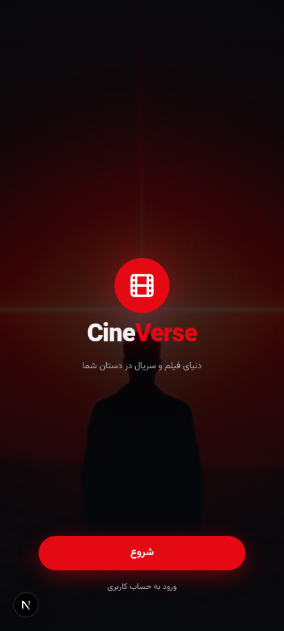
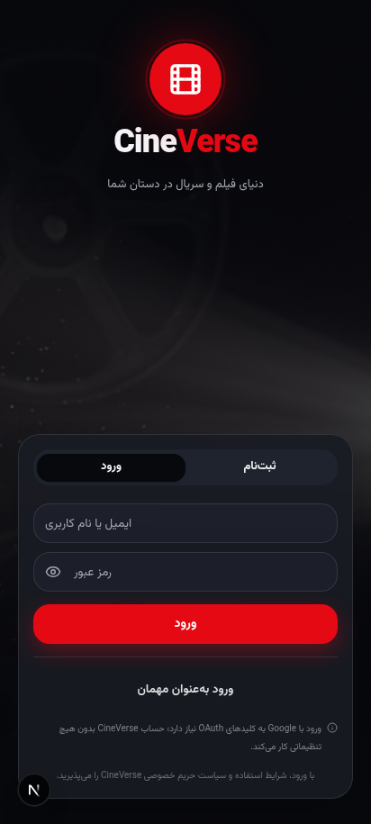
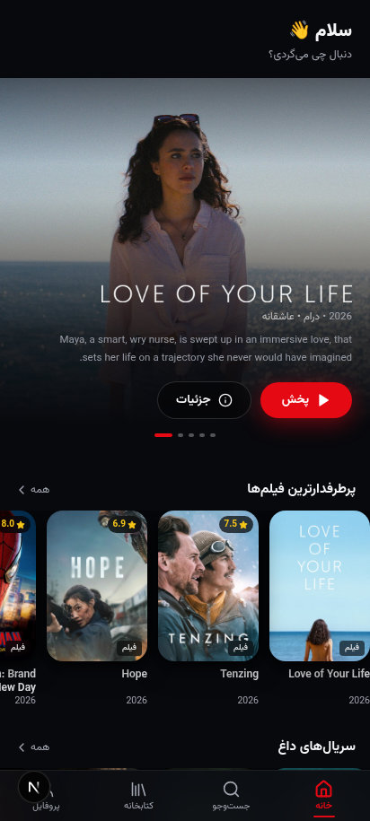
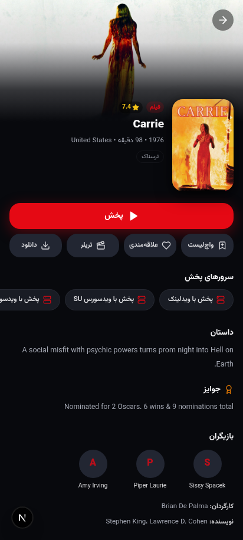
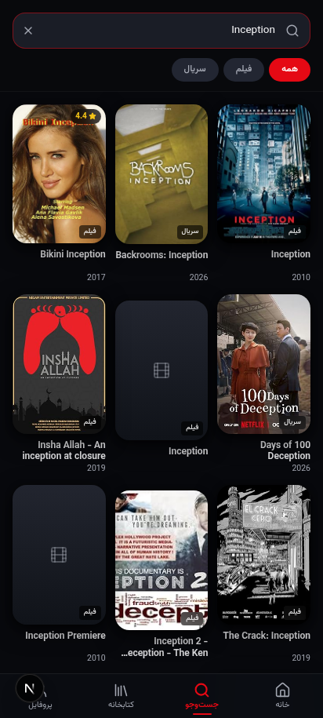
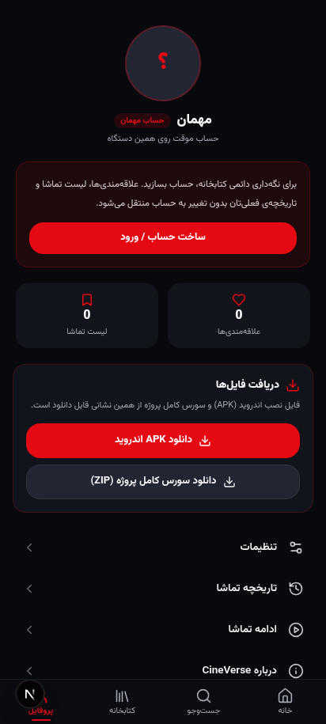

<div align="center">

# 🎬 CineVerse

**The world of movies & series in your hands.**

A Persian-first (RTL) streaming experience — live metadata for virtually every movie & TV show,
six interchangeable playback servers, Persian subtitles, direct downloads, zero-config accounts,
packaged as a **mobile web app** and a **native Android APK**.

[](https://nextjs.org)
[](https://www.typescriptlang.org)
[](README.md#-android-app)
[](LICENSE)
[](README.md#-extending--contributing)

**Built by [Alireza Rajaee](https://github.com/alirezarajaee)**

[🇮🇷 نسخه فارسی](README.fa.md)

</div>

---

## ✨ Features

| | Feature | Details |
|---|---|---|
| 🗄️ | **Live complete catalog** | Connected to **Cinemeta** (the IMDb-backed database of Stremio) — no API key required. Search millions of movies & series with posters, ratings, plots, genres, cast, and real season/episode trees. |
| ▶️ | **Play anything you search** | **6 interchangeable embed servers** (switchable live from the player) plus a **direct-file mode** (MP4 / HLS via `hls.js`) with real quality & audio-track selection. |
| ⬇️ | **Downloads** | Direct-download resolver (Internet Archive for free/public-domain titles) with honest fallback messaging, plus the native `DownloadManager` inside the Android app. |
| 📝 | **Persian subtitles, done right** | Custom **RTL subtitle engine** (VTT/SRT parser + renderer with full Persian typography) and auto-fetch from **OpenSubtitles**. |
| 🔑 | **Zero-config authentication** | Email/username + password accounts (bcrypt) **and** a real guest mode — works with no setup at all. Guest libraries migrate automatically when you register. Optional Google Sign-In compiles in but only activates with your own OAuth credentials. |
| 💾 | **Personal library** | Favorites, Watchlist, Continue Watching, Watch History — persisted server-side in SQLite, per user. |
| 🎛️ | **Settings that stick** | Default playback server, default quality, subtitle language, autoplay-next, data-saver, privacy toggles — optimistic UI with server persistence. |
| 🌙 | **Cinematic design system** | Dark palette (`#08090D` / `#191C24` / accent `#E50914`), Vazirmatn typeface, full RTL layout, phone-frame on desktop, real app-like navigation (stack + tabs). |

## 📸 Screenshots

| Splash | Welcome | Home |
|---|---|---|
|  |  |  |

| Detail (live IMDb data) | Search (live results) | Profile & Downloads |
|---|---|---|
|  |  |  |

> All screenshots are real captures of the running app with live metadata.

## 🚀 Quick Start (Web)

```bash
# 1. Install dependencies
bun install

# 2. Configure environment
cp .env.example .env        # then set DATABASE_URL and a random AUTH_SECRET

# 3. Create the SQLite schema
bun run db:push

# 4. Run
bun run dev                 # http://localhost:3000
```

Requirements: Node 20+ (or Bun 1.1+). The app runs entirely on Next.js App Router + Prisma (SQLite).

## 📱 Android App

A native Android wrapper (**com.cineverse.app**, minSdk 24 → targetSdk 34) ships with this repo:

- Fullscreen WebView with the same dark theme and an app icon in 5 densities
- **First-launch dialog asks for the server URL** (the address where you host this web app) and stores it locally
- Native **DownloadManager** so downloads land in the system Downloads folder
- Fullscreen video support, external links opened in the browser, back-button navigation
- JS bridge (`window.CineVerseNative`) — the app's Profile screen detects the native shell and exposes a "change server URL" action
- Only two permissions: `INTERNET`, `ACCESS_NETWORK_STATE`

**Option A — grab the prebuilt APK:** see the repo's [Releases](../../releases).

**Option B — build it yourself (no Android Studio, no Gradle):**

```bash
# Requires: any JDK 8+ (java/keytool), Android SDK platform-34 + build-tools 34.0.0
# See android/README-ANDROID.md for one-command SDK setup
cd android
./build.sh
# → out/CineVerse.apk (signed, ready to install)
```

The wrapper is compiled manually via `aapt2 → ecj → d8 → zipalign → apksigner` — see
[`android/README-ANDROID.md`](android/README-ANDROID.md) for the full toolchain walkthrough
(including the `ecj -bootclasspath` trick needed to compile against `android.jar` on modern JDKs).

## 🏗️ Architecture

```
src/
├─ app/
│  ├─ page.tsx                 # single UI route — the app renders as an internal SPA
│  ├─ layout.tsx               # RTL, lang=fa, Vazirmatn font, PWA manifest
│  └─ api/                     # route handlers
│     ├─ auth/{register,login,guest,session,logout,google…}
│     ├─ home / search / catalog / metadata/detail
│     ├─ sources / subtitles   # playback servers + Persian subtitle proxy
│     └─ library/{favorites,watchlist,history} · settings · account/delete
├─ components/cineverse/
│  ├─ App.tsx                  # root: splash → welcome → tabs + stack + player overlay
│  ├─ screens/                 # Home, Search, Catalog, Detail, Library, History,
│  │                           # Profile, Settings, About, Welcome, Splash
│  └─ player/WatchScreen.tsx   # embed mode (6 servers) + file mode (hls.js, subtitles)
└─ lib/
   ├─ providers/metadata.ts    # Cinemeta adapter (10-min cache, host fallback, retry)
   ├─ providers/sources.ts     # playback-server adapter
   ├─ providers/subtitles.ts   # OpenSubtitles adapter + same-origin proxy
   ├─ download.ts              # direct-download resolver (Internet Archive)
   ├─ session.ts               # HMAC-signed cookie, real guest users, in-place upgrade
   ├─ store.ts                 # Zustand navigation stack + player + session state
   ├─ subtitles.ts             # VTT/SRT parser + RTL subtitle renderer
   └─ api.ts · types.ts · format.ts · db.ts
android/                       # native APK project (build.sh, no Gradle)
public/                        # art, icons, PWA manifest, demo subtitles
prisma/schema.prisma           # User, UserSettings, Favorite, WatchlistItem,
                               # WatchHistoryEntry, SearchQuery
```

**Design principle — adapters everywhere.** The UI never talks to external services directly:
metadata, playback sources and subtitles all sit behind small provider modules. Swapping any
provider (e.g., moving to TMDb, a licensed CDN, or a paid subtitle API) means editing **one file**.

## 🔍 How the data layer works

- **Metadata — Cinemeta:** public, key-less, IMDb-identifiers (`tt…`) as the canonical ID. 10-minute in-memory cache, stale-while-revalidate, automatic host fallback with retry.
- **Playback:** the detail endpoint exposes available servers; the player lets you switch live and persists your default. Embed servers are third-party public services — availability depends on their networks, so the UI is honest when a server fails and suggests another.
- **Downloads:** for titles with freely licensed copies (e.g., public-domain films on the Internet Archive) a direct MP4 link is resolved in the browser; otherwise the UI says so plainly instead of pretending.
- **Subtitles:** OpenSubtitles addon for real Persian tracks + users can load their own SRT/VTT files; the RTL engine renders them with proper Persian shaping.

## 🔐 Authentication model

- **Default (zero configuration):** register with email/username + password; guests get a real server-side session so their library survives reloads; registering upgrades the guest **in place** (library is preserved).
- **Sessions:** `httpOnly` cookie signed with HMAC-SHA256 (`AUTH_SECRET`); passwords hashed with bcrypt (cost 10); account deletion cascades all personal data.
- **Google Sign-In:** the full OAuth 2.0 code-exchange flow is implemented; it only renders once `GOOGLE_CLIENT_ID` / `GOOGLE_CLIENT_SECRET` are present in `.env`. No fake buttons — if it isn't configured, it isn't shown.

## 🧪 Quality

- `bun run lint` — 0 errors, 0 warnings
- TypeScript strict across the whole API surface and UI
- Every feature table above was exercised end-to-end in a real browser (screenshots in `docs/screenshots/`)

## 🤝 Extending & Contributing

**Anyone who wants to extend, modify, fork or build upon this project is absolutely welcome to do
so — no permission needed.** That's exactly what the MIT license means here.

Ideas that fit the existing adapter seams:

- Add a new playback server → one entry in `lib/providers/sources.ts`
- Swap metadata to TMDb or another provider → `lib/providers/metadata.ts`
- Add subtitle languages → `lib/providers/subtitles.ts`
- Port the UI to React Native — the screens, state model and REST API map 1:1

Bug fixes, new features and UX improvements are welcome: fork → branch → PR.

## ⚠️ Honest notes

- Playback servers and subtitle services are **third-party public services**; availability and
  quality depend on them and on your network. This project does not host or proxy any media itself.
- The prebuilt APK is signed with a **development (debug) key** for testing.
- For a commercial deployment, replace providers with licensed sources.

## 📄 License

[MIT](LICENSE) © Alireza Rajaee — free to use, modify, extend and redistribute.

## 🙏 Acknowledgements

- [Cinemeta](https://github.com/Stremio/stremio-addon-sdk) — metadata
- [OpenSubtitles](https://opensubtitles.com) — subtitles
- [Blender Foundation](https://www.blender.org) & [Mux](https://mux.com) — reference HLS streams
- [Internet Archive](https://archive.org) — public-domain download source
- [Vazirmatn](https://github.com/rastikerdar/vazirmatn) — the Persian typeface

---

<div align="center">

**CineVerse** — *Built by Alireza Rajaee*

</div>
